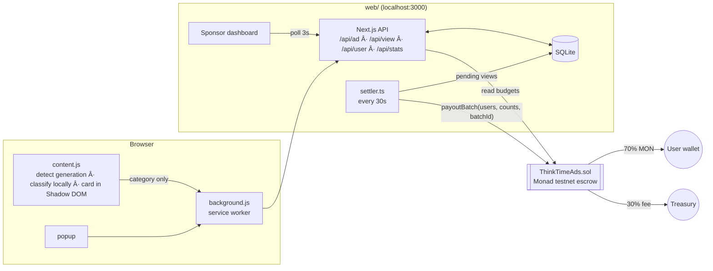

# ThinkTime — get paid for the ads you see while AI is thinking

ChatGPT now shows ads to free users, and OpenAI keeps 100% of the ad money. **ThinkTime** is a Chrome extension that shows a small sponsored card while ChatGPT, Claude or Gemini is generating an answer, and pays the **user** a share of every verified view, on-chain on Monad. Sponsors fund campaigns in an escrow contract and only pay for views that pass anti-spam checks. **The user's prompt never leaves their browser**: only a coarse category (e.g. "coding") is used for ad matching.

Built for the Monad "Metropolis" hackathon, Track 03: Social, Attention & Culture.

## Architecture



Layout: `contracts/` (Foundry), `web/` (Next.js 15: API + dashboard + settler + simulator), `extension/` (MV3, plain JS, no build step).

## Why on-chain

- **Transparent sponsor escrow**: budgets sit in the contract. A sponsor can see exactly what's left, and the platform can't spend more than was funded.
- **Every payout is publicly verifiable**: each batch is a Monad tx with `ViewsPaid` / `BatchSettled` events; the dashboard links straight to the explorer.
- **Micro-payouts to anyone with an address**: no accounts, KYC or minimum payout threshold. Monad's low fees and fast finality make 0.0007 MON payouts viable.
- **Replay-proof settlement**: `batchId` can only be settled once.

**Honest caveat:** view attestation is *trusted*. The backend (attestor key) decides which views count, and a malicious extension could lie about attention. On-chain guarantees only cover money flow (budget caps, no double settlement, public record), not whether a human really watched. The anti-spam rules below bound the damage a cheater can do: at most 50 views/day/wallet, 1 per 20s, 2 wallets per install, so ≈ 0.035 MON/day per wallet at the demo rate. Real deployments would add attention proofs, device attestation, or multiple attestors.

## Anti-spam rules (enforced in `web/lib/views.ts`)

A view is stored but **rejected** (with reason) if:

| Reason | Rule |
|---|---|
| `invalid` | bad address / missing fields / unknown campaign |
| `replay` | `viewId` already seen |
| `too_short_generation` | `generationMs < 3000` |
| `not_attended` | `visibleMs < 5000` or not focused (card dismissed, tab hidden, window unfocused) |
| `rate_limited` | same address had a counted view < 20 s ago |
| `daily_cap` | address already has 50 counted views today (UTC) |
| `install_abuse` | one `installId` used with > 2 different addresses |

## Privacy

- The prompt is read **only inside the content script** and classified with local keyword rules (`extension/classify.js`, no network).
- Only the category string, a random view UUID, durations, your wallet address and an anonymous install ID reach the backend.
- The card is rendered in a closed Shadow DOM and is never inserted into the model's response area.

## Setup

Prereqs: Node 20+, [Foundry](https://book.getfoundry.sh/), Chrome.

### 1. Fund a key
Use a **throwaway testnet key**. It will be deployer, owner, attestor, treasury and demo sponsor.
```bash
curl -X POST https://agents.devnads.com/v1/faucet -H "Content-Type: application/json" -d '{"chainId":10143,"address":"0xYOUR_ADDRESS"}'
```
The faucet gives ~1 MON per call. The seed needs 2 MON at the default budget (see `SEED_BUDGET_WEI` below).

### 2. Test, deploy, seed
```bash
cd contracts
forge install foundry-rs/forge-std --no-git   # first time only
forge test
forge script script/Deploy.s.sol --rpc-url monad_testnet --broadcast --private-key $PRIVATE_KEY
# note the printed address, then:
export CONTRACT_ADDRESS=0x...
forge script script/Seed.s.sol --rpc-url monad_testnet --broadcast --private-key $PRIVATE_KEY
# less than ~2.5 MON? shrink the per-campaign budget, e.g. SEED_BUDGET_WEI=300000000000000000
```
Seed creates campaigns 0–3 (0.5 MON each, 0.001 MON/view) matching `web/lib/ads.ts`.

### 3. Run the backend
```bash
cd web
cp .env.example .env.local   # fill in PRIVATE_KEY and CONTRACT_ADDRESS (never commit)
npm install
npm run dev:all              # Next on :3000 + settler loop (every 30s)
```
Open http://localhost:3000/dashboard.

### 4. Load the extension
`chrome://extensions` → Developer mode → **Load unpacked** → select `extension/`. Click the ThinkTime icon, paste your wallet address, Save.

### Simulator (also the demo fallback if a site's DOM breaks)
```bash
cd web
npm run simulate             # ~45 s against default limits
# to also show daily_cap quickly: start the server with DEMO_FAST=1 (set it in .env.local), then
npm run simulate -- --fast
```

## 2-minute demo script

1. Show the dashboard with four funded campaigns and live budgets.
2. Ask ChatGPT a coding question. The **Kernel Coffee** card appears while it generates and the earning indicator fills.
3. Repeat on Claude and Gemini.
4. Open the popup. Views show as pending, and within 30 s they become paid with a real Monad tx link.
5. Run `npm run simulate`. The dashboard's **Spam blocked** panel fills up.
6. Close: *"OpenAI keeps 100% of your attention. ThinkTime gives it back."*

## Decisions & notes

- Single key = deployer/owner/attestor/treasury/sponsor for hackathon simplicity; the contract supports separate roles (`setAttestor`, `setTreasury`).
- Fee split: user gets `amount * 70%`, treasury the rest. Failed pushes to a user are credited to `claimable` and withdrawn with `claim()`.
- The settler estimates gas then adds a 20% buffer, because Monad charges on gas *limit*, not gas used.
- Settler batches at most 40 users per transaction and skips a campaign (leaving views pending) if its on-chain budget can't cover the batch.
- Replayed/invalid payloads are stored under synthetic IDs (`replay:<uuid>`) because `viewId` is the primary key.
- Backend is local-only (`npm run dev`); SQLite lives at `web/data/thinktime.db`.
- `focused` is client-attested: the extension only accrues `visibleMs` while the tab is visible and focused and the card is ≥ 50% on screen.
- The dashboard budget bar shows remaining ÷ (remaining + paid out) since top-ups aren't tracked separately.
- TypeScript is pinned to 5.x (Next 15's config loader doesn't work with TS 7).

## Known limitations

- **Site selectors are unverified against the live logged-in sites.** They live in `extension/sites.js` as fallback lists, plus a generic "visible button with aria-label /stop/i near the composer" fallback. If a card doesn't appear, edit the selector for that site (one line). The simulator is the fallback.
- Backend must be running on `localhost:3000` (`API` constant in `extension/background.js`).
- Attestation is trusted (see above); no sybil resistance beyond the listed rules; testnet only.
- Ads are fictional and link to `example.com`.

